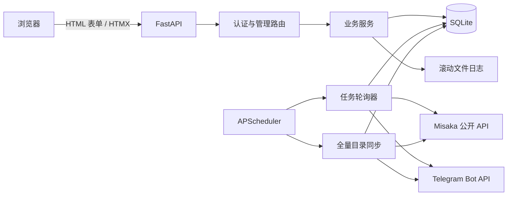
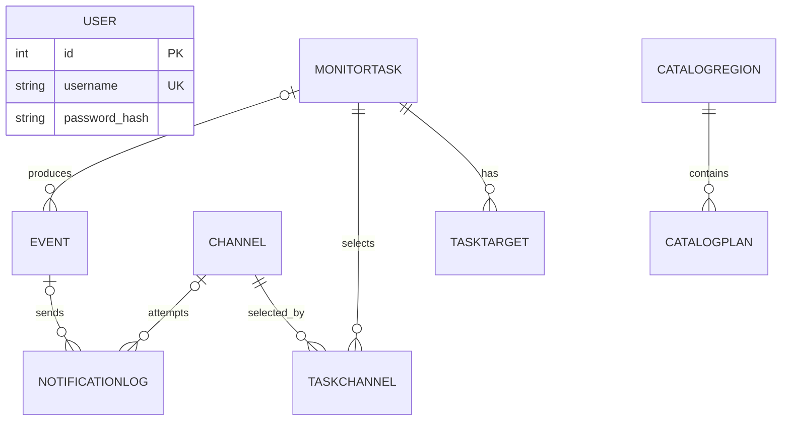

# Misaka 补货监控系统开发文档

> 文档基线：2026-10-09 · v1.0.0  
> 适用范围：本仓库中的 FastAPI 管理后台、轮询调度、目录快照、事件记录和 Telegram 通知  
> 文档目的：用于项目留档、部署恢复、故障排查和后续二次开发

## 1. 项目概述

本项目是一个面向 Misaka IaaS 产品的自托管补货监控后台。系统定期调用 Misaka 公开接口，保存区域和套餐快照，比较前后状态，生成补货、售罄、价格变化、规格变化等事件，并按监控任务配置发送 Telegram 通知。

系统当前提供以下能力：

- 单管理员登录和 14 天签名会话；
- 全站区域、套餐目录同步和网页浏览；
- 按单个套餐、整个区域或全站通配目标创建监控任务；
- 每个任务独立设置轮询间隔、事件类型和通知渠道；
- 多个 Telegram 渠道及测试发送；
- SQLite 事件审计、通知结果记录和滚动文件日志；
- Docker Compose 单机部署和健康检查；
- 自动下单扩展接口。

当前明确不具备的能力：

- 自动下单没有真实实现，现有执行器只返回提示，不会提交订单；
- 没有多租户、角色权限、开放业务 API 或集群调度；
- 没有 Alembic 等正式数据库迁移框架；
- 没有自动化测试、CI/CD、指标监控和告警闭环；
- 通知渠道实际只实现 Telegram，Bark、Webhook、邮件仅在模型设计上预留。

## 2. 技术栈与运行约束

| 层次 | 技术 | 当前版本/说明 |
| --- | --- | --- |
| Web 框架 | FastAPI | 0.138.2 |
| ASGI 服务 | Uvicorn | 0.49.0，包含 standard 扩展 |
| ORM/模型 | SQLModel | 0.0.39 |
| 数据库 | SQLite | 单文件 `misaka.db` |
| HTTP 客户端 | HTTPX | 0.28.1，异步请求 |
| 调度器 | APScheduler | 3.11.3，进程内 `AsyncIOScheduler` |
| 模板 | Jinja2 | 3.1.6，服务端渲染 |
| 前端交互 | HTMX + Pico CSS | 静态资源已随项目本地化 |
| 会话 | Starlette SessionMiddleware | `itsdangerous` 签名 Cookie |
| 配置 | python-dotenv | 根目录 `.env` |
| 容器 | Python 3.12 slim | `Dockerfile` 固定基础镜像系列 |

开发环境可使用依赖支持的新版 Python，但生产环境建议与容器保持 Python 3.12。调度器和 SQLite 都要求本服务以单进程、单副本方式运行：不要增加 `uvicorn --workers`，也不要同时启动多个容器，否则每个进程都会重复创建定时任务，并且进程内锁无法协调跨进程写入。

## 3. 总体架构



系统是单体应用，网页、认证、调度和后台轮询运行在同一个 Uvicorn 进程中。SQLite 同时承担配置、目录快照、任务状态和审计记录存储。`./data` 是唯一需要持久化和备份的运行数据目录。

## 4. 目录结构

```text
misaka-deploy/
├─ app/
│  ├─ api/                    # 页面路由与表单处理
│  │  ├─ auth.py             # 登录、退出
│  │  ├─ catalog.py          # 产品目录与手动同步
│  │  ├─ channels.py         # Telegram 渠道管理
│  │  ├─ tasks.py            # 监控任务 CRUD、启停、立即运行
│  │  ├─ logs.py             # 事件查询、CSV 和文件日志
│  │  └─ settings.py         # 系统设置、修改密码
│  ├─ services/
│  │  ├─ catalog.py          # 快照规范化、差异检测、全量同步
│  │  ├─ misaka_client.py    # Misaka API 客户端与短期缓存
│  │  ├─ poller.py           # 单任务轮询和全局事件路由
│  │  ├─ scheduler.py        # APScheduler 作业装配
│  │  ├─ events.py           # 事件常量和中文标签
│  │  ├─ messages.py         # Telegram 消息格式
│  │  ├─ logbook.py          # 滚动文件日志
│  │  ├─ notifier/           # 通知扇出及 Telegram 实现
│  │  └─ order/              # 自动下单抽象和 Noop 实现
│  ├─ templates/             # Jinja2 页面模板
│  ├─ static/                # Pico CSS、HTMX、自定义样式
│  ├─ config.py              # 环境变量配置
│  ├─ db.py                  # 数据库引擎、初始化、轻量迁移、设置读写
│  ├─ deps.py                # 当前用户和认证依赖
│  ├─ models.py              # SQLModel 数据模型
│  ├─ security.py            # PBKDF2 密码哈希
│  ├─ templating.py          # 模板环境、时区过滤器、Flash
│  ├─ util.py                # slug、价格、容量和下单链接工具
│  └─ main.py                # 应用入口和生命周期
├─ data/
│  ├─ misaka.db              # SQLite 数据库，运行时生成
│  └─ logs/events.log        # 事件文件日志，运行时生成
├─ .env                      # 实际环境配置，不应提交或公开
├─ .env.example              # 环境变量模板
├─ requirements.txt          # 锁定的 Python 依赖
├─ Dockerfile
├─ docker-compose.yml
├─ DEPLOY.md                 # 原有精简部署说明
└─ DEVELOPMENT.md            # 本文档
```

`.venv`、`__pycache__`、数据库和日志都是本地运行产物，不属于源代码交付物。

## 5. 应用生命周期

入口为 `app.main:app`。FastAPI lifespan 按以下顺序执行：

1. `init_db()` 创建缺失的数据表；
2. `_migrate()` 为旧库补充 `catalogplan.category` 和 `catalogregion.continent`，并尝试从原始 JSON 回填；
3. 如果数据库中没有任何用户，使用环境变量创建初始管理员；
4. 写入尚不存在的默认设置项；
5. 启动进程内 APScheduler；
6. 为所有已启用任务恢复轮询作业；
7. 创建全局目录同步作业；
8. 如果套餐目录为空，在约 1 秒后执行首次全量同步；
9. 应用停止时关闭调度器，但不等待正在运行的作业完成。

用户表为空时自动创建默认管理员 `admin / admin`（`db.DEFAULT_ADMIN_*`），并置 `User.must_change_password=True`。`require_user` 遇到该标记会抛出 `PasswordChangeRequired`，统一重定向到 `/account/setup`，设置新密码（不少于 6 位、不能为 `admin`）后才能访问其它页面；任何时候用默认密码登录成功也会重新置位该标记。忘记密码时运行 `python -m app.reset_admin`（Docker：`docker compose exec misaka-monitor python -m app.reset_admin`），会把第一个账号重置为 `admin / admin` 并要求重新设置。`.env` 中的 `ADMIN_USERNAME` / `ADMIN_PASSWORD` 已不再读取。

## 6. 核心业务流程

### 6.1 全量目录同步

全量同步由以下三种方式触发：

- 数据库无套餐时，启动约 1 秒后建立基线；
- `global_sync` 按 `catalog_sync_hours` 周期执行；
- 管理员在产品目录页手动点击“刷新目录”。

处理过程：

1. 请求 `GET /mc2/regions` 获取区域；
2. 串行请求每个区域的套餐接口；
3. 规范化区域和套餐字段；
4. 在 `catalog_lock` 内比较数据库快照并执行 upsert；
5. 写入全局审计事件，即 `Event.task_id` 为空；
6. 将事件匹配到启用任务的订阅类型和目标；
7. 为每个命中任务写一条任务维度事件并向该任务渠道发送通知；
8. 保存 `last_catalog_sync`。

首次全量同步只建立基线，不产生 `new_region` 或 `new_plan` 事件，也不会把现有库存当成补货。后续同步才根据快照差异产生事件。

某个区域套餐接口发生 HTTP 错误时，该区域被记为空列表并跳过下架判定，以降低临时网络故障造成误报的概率。区域接口整体失败时，同步直接失败并保留旧快照。

### 6.2 单任务轮询

每个启用任务对应一个 APScheduler interval 作业，实际周期为：

```text
max(系统最小轮询间隔, 任务配置间隔)
```

任务轮询步骤：

1. 读取任务、目标、订阅事件和渠道；
2. 忽略 `region='*'` 的全站通配目标，这类目标只由全量同步处理；
3. 按区域合并目标，每个区域只请求一次套餐接口；
4. 使用 4 秒进程内缓存合并短时间内不同任务的同区域请求；
5. 只处理已由全量目录收录的套餐；
6. 在 `catalog_lock` 内比较并更新快照，记录任务维度事件；
7. 释放锁后调用通知渠道，避免网络发送长时间占锁；
8. 更新事件的 `notified`、任务的 `last_run_at` 和 `last_status`。

`catalog_lock` 保证同一进程内全量同步和任务轮询不会同时修改同一快照，因此一次状态跳变通常只产生一次通知。该保证不跨进程，所以生产环境必须保持单实例。

### 6.3 首次、手动与恢复状态报告

- 任务第一次实际运行时，向已选渠道推送“已开始监控”状态汇总；
- 点击“运行”会强制推送“当前库存状态”；
- 从停用切换为启用时会立即运行，并推送“已恢复监控”；
- 状态汇总最多列出 20 个目标，其余只显示总数；
- 如果没有渠道或没有抓到有效目标，不发送状态汇总。

### 6.4 通知扇出

每条任务事件依次发送到所有存在且启用的渠道。每次发送都会写入 `NotificationLog`，状态为 `ok` 或 `failed`。只要至少一个渠道成功，事件的 `notified` 就设为真。

Telegram 请求为：

```text
POST https://api.telegram.org/bot{TOKEN}/sendMessage
```

请求体包含 `chat_id`、纯文本 `text`，并关闭网页预览。默认超时 20 秒。当前按渠道串行发送，没有重试、退避、限流或失败补发队列。

### 6.5 自动下单

`OrderExecutor` 已定义统一异步接口，补货事件且任务开启 `auto_order` 时会调用它。当前固定返回 `NoopOrderExecutor`：只记录“将下单”意图，并在通知里说明功能未启用，不执行登录、下单或付款。

因此，管理页面中的“自动下单”复选框不能理解为已经具备真实下单能力。

## 7. 目标匹配规则

| 目标存储值 | 含义 | 数据来源 |
| --- | --- | --- |
| `REGION / plan-slug` | 单个区域内的单个套餐 | 高频任务轮询 + 全量同步 |
| `REGION / *` | 整个区域内所有已知套餐及目录事件 | 高频任务轮询 + 全量同步 |
| `* / *` | 全站目录事件 | 仅全量同步 |

区域 slug 写入时转为大写，套餐 slug 写入时转为小写。区域级事件的 `plan_slug` 为空；只要任务目标属于该区域，或使用全站通配，就可匹配该区域事件。

整区目标在高频轮询时会检查接口返回的全部套餐，但未知套餐不会由任务轮询直接入库，新套餐必须等全量同步识别，以免掩盖 `new_plan` 事件。

## 8. 事件模型

| 事件代码 | 中文含义 | 触发条件 | 产生位置 |
| --- | --- | --- | --- |
| `restock` | 补货 | 套餐 `available: false -> true` | 任务轮询、全量同步 |
| `sold_out` | 售罄 | 套餐 `available: true -> false` | 任务轮询、全量同步 |
| `price_change` | 价格变更 | `price_monthly` 发生变化 | 任务轮询、全量同步 |
| `spec_change` | 规格变更 | vCPU、内存、磁盘、流量或 NVMe 变化 | 任务轮询、全量同步 |
| `new_plan` | 新规格上线 | 非首次全量同步发现新套餐 | 仅全量同步 |
| `removed_plan` | 规格下架 | 已成功抓到且非空的区域中，旧套餐不再返回 | 仅全量同步 |
| `new_region` | 新区域上线 | 非首次全量同步发现新区域 | 仅全量同步 |
| `removed_region` | 区域下架 | 类型已预留，但当前代码没有生成逻辑 | 尚未实现 |
| `region_availability` | 区域可用性变化 | 区域 `available` 发生变化 | 仅全量同步 |

事件包含旧快照 `old`、新快照 `new`、人类可读详情、任务 ID 和通知结果。全量同步先写一条无任务 ID 的审计事件，再为每个匹配任务写副本，因此数据库中同一次业务变化可能存在一条全局记录和多条任务记录，这是当前设计，不是重复写入故障。

`MonitorTask.notify_policy` 当前固定为 `once`，代码未按该字段分支。所谓“一次”由持久化快照实现：只在状态发生跳变时产生事件，并不是永久只通知一次。

## 9. 配置说明

### 9.1 环境变量

环境变量由根目录 `.env` 加载。Docker Compose 也读取该文件，并把容器内的 `DATA_DIR` 固定为 `/data`；`MISAKA_PORT`、`MISAKA_VERSION` 只供 Compose 使用（宿主机端口、镜像版本）。

| 变量 | 默认值 | 用途 | 变更生效方式 |
| --- | --- | --- | --- |
| `ADMIN_USERNAME` / `ADMIN_PASSWORD` | — | 已废弃，不再读取；默认账号固定为 `admin / admin` | — |
| `APP_SECRET_KEY` | 随机生成 | 签名会话 Cookie | 重启后生效，必须持久固定 |
| `DISPLAY_TZ` | `Asia/Shanghai` | 首次写入展示时区设置 | 仅对应设置不存在时 |
| `MISAKA_PORT` | `8000` | Compose 宿主机端口映射 | `docker compose up -d` |
| `MISAKA_VERSION` | `latest` | Compose 使用的镜像标签 | `docker compose pull && up -d` |
| `DATA_DIR` | 项目根目录下 `data` | 数据库和日志目录 | 重启后生效 |
| `CATALOG_SYNC_HOURS` | `24` | 首次写入全量同步周期 | 仅对应设置不存在时 |
| `MIN_INTERVAL_SECONDS` | `15` | 首次写入任务轮询下限 | 仅对应设置不存在时 |
| `MISAKA_API_BASE` | `https://app.misaka.io/api` | Misaka API 基地址 | 重启后生效 |

生产环境必须设置强随机 `APP_SECRET_KEY`。如果留空，应用每次启动都会生成新值，已有登录会话随重启失效，多进程之间也无法共享会话。

### 9.2 数据库运行设置

以下设置保存在 `Setting` 表，后台保存后优先于环境变量初始值：

| Key | 含义 |
| --- | --- |
| `display_tz` | 页面时间展示所用 IANA 时区 |
| `catalog_sync_hours` | 全量目录同步周期，代码下限 0.1 小时 |
| `min_interval_seconds` | 所有任务的实际轮询周期下限 |
| `last_catalog_sync` | 最近一次成功完成同步的 UTC 时间 |
| `sync_log_types` | 同步日志记录的事件类型（逗号分隔），默认价格/规格/上下架/区域变化，不含补货售罄 |
| `task_log_types` | 监控事件记录的事件类型（逗号分隔），默认补货、售罄 |
| `log_enabled` | 是否把上述已记录的事件同时写入 `events.log` |
| `notify_target_invalid` | 同步后检查启用任务的指定套餐目标是否下架/恢复并推送提醒，默认开启 |

事件日志按来源区分：`Event.task_id` 为空的是**同步日志**（全量目录同步产生），非空的是**监控事件**（任务轮询，或同步事件命中任务订阅后按任务记录）。`record_events()` 按来源读取对应的记录类型，未记录的事件返回 `None`，**不影响 Telegram 推送**（推送仍按任务的 `event_types` 订阅）。

**目标失效提醒**：`run_global_sync()` 在路由事件后调用 `check_target_validity()`，逐个检查启用任务中指定了套餐的目标（整区 `region|*` 与全站 `*|*` 不检查）：目录中已不存在 → 记录 `target_invalid` 监控事件并推送「监控目标失效」；之前失效、现已重新出现 → 记录 `target_restored` 并推送「监控目标恢复」。状态保存在 `TaskTarget.missing_since`，每次变化只通知一次，编辑任务时保留。该提醒与任务的事件订阅无关；`target_*` 属于 `SYSTEM_EVENTS`，总是记录。目录为空或目标所在区域没有任何套餐数据时跳过判断，避免抓取失败误报。

旧版的 `log_restock`、`log_sold_out` 等分项开关已停用，旧库中残留的这些 Key 不再被读取。

## 10. 数据库设计

数据库路径为 `${DATA_DIR}/misaka.db`。SQLModel 默认表名为类名小写。

### 10.1 表清单

| 表 | 主键 | 主要字段 | 用途 |
| --- | --- | --- | --- |
| `user` | `id` | username, password_hash, created_at | 管理员账号 |
| `channel` | `id` | type, name, bot_token, chat_id, enabled | 通知渠道 |
| `monitortask` | `id` | name, enabled, interval_seconds, event_types, notify_policy, auto_order, order_params, last_run_at, last_status | 监控任务 |
| `tasktarget` | `id` | task_id, region, plan_slug | 任务目标 |
| `taskchannel` | `id` | task_id, channel_id | 任务与渠道关联，组合唯一 |
| `catalogregion` | `slug` | name, country, continent, available, raw, first_seen, last_seen, last_changed | 区域快照 |
| `catalogplan` | `id` | region, slug, category, 规格、价格、库存、raw、时间戳 | 套餐快照，区域和 slug 组合唯一 |
| `event` | `id` | ts, type, region, plan_slug, old, new, detail, task_id, notified | 业务事件和审计 |
| `notificationlog` | `id` | ts, channel_id/name, task_id, event_id, status, error | 每次通知尝试结果 |
| `setting` | `key` | value | 运行设置 |

### 10.2 关系



模型中只声明了部分外键，代码没有使用 ORM relationship 或级联删除。删除任务时会显式删除目标和渠道关联，但保留历史事件及通知记录；删除渠道时当前不会清理 `TaskChannel` 残留关联，发送时会跳过不存在的渠道。

### 10.3 时间与 JSON

- 数据库时间统一保存为无时区信息的 UTC `datetime`；
- 页面展示时按 `display_tz` 转换；
- Telegram 消息时间使用服务器本地时区，不使用 `display_tz`；
- `event_types`、`order_params`、套餐/区域原始响应及事件新旧快照使用 SQLite JSON 列。

### 10.4 迁移策略

当前迁移函数只支持两个历史变更：

- 为 `catalogplan` 增加 `category`；
- 为 `catalogregion` 增加 `continent`。

新增其他列、索引、约束或数据变换前，应引入 Alembic，或至少编写带版本号、幂等且有备份验证的迁移。不要依赖 `SQLModel.metadata.create_all()` 修改现有表结构，它只会创建缺失表。

## 11. Web 路由清单

除登录、退出、健康检查和 FastAPI 自动文档外，其余业务路由都调用 `require_user`。退出接口虽然不要求已登录，但只会清除当前请求携带的会话。

| 方法 | 路径 | 认证 | 功能 |
| --- | --- | --- | --- |
| GET | `/healthz` | 否 | 返回应用与调度器状态 |
| GET | `/` | 是 | 仪表盘统计和最近 10 条事件 |
| GET | `/login` | 否 | 登录页 |
| POST | `/login` | 否 | 校验账号密码并写入会话 |
| GET | `/logout` | 否 | 清空会话并跳转登录页 |
| GET | `/catalog` | 是 | 区域目录、搜索和库存汇总 |
| GET | `/catalog/r/{region}` | 是 | HTMX 区域/分类套餐片段 |
| POST | `/catalog/refresh` | 是 | 手动全量同步并路由事件 |
| GET | `/channels` | 是 | 渠道列表 |
| POST | `/channels` | 是 | 新建 Telegram 渠道 |
| POST | `/channels/{cid}/update` | 是 | 修改渠道，空 Token 表示保留原值 |
| POST | `/channels/{cid}/delete` | 是 | 删除渠道 |
| POST | `/channels/{cid}/test` | 是 | 发送 Telegram 测试消息 |
| GET | `/tasks` | 是 | 任务列表和当前快照状态 |
| POST | `/tasks/new` | 是 | 接收目录勾选项并展示创建表单 |
| POST | `/tasks/create` | 是 | 创建任务、目标、渠道关联和调度作业 |
| GET | `/tasks/{tid}/edit` | 是 | 编辑表单 |
| POST | `/tasks/{tid}/update` | 是 | 更新任务并重建目标/渠道关联 |
| POST | `/tasks/{tid}/toggle` | 是 | 启停任务；启用时立即运行 |
| POST | `/tasks/{tid}/delete` | 是 | 删除任务配置及调度作业 |
| POST | `/tasks/{tid}/run` | 是 | 立即运行并推送状态汇总 |
| GET | `/logs` | 是 | 事件浏览：`src`=task/sync 来源页签，`cat`=stock/price_spec/listing 分类，`type` 具体事件类型，`product`=`REGION\|slug` 单个产品时间线（区域级事件 slug 为空），`view`=list 事件列表 / product 按产品聚合，`task` 任务，`q` 关键词，列表每页 50 条 |
| GET | `/logs/export.csv` | 是 | 按相同筛选导出最近 5000 条事件（UTF-8 BOM，含来源与任务名） |
| POST | `/logs/settings` | 是 | 保存日志记录规则（`sync_types` / `task_types` / `log_enabled`），入口为日志页「记录设置」弹窗 |
| POST | `/logs/clear` | 是 | 清空日志：`scope`=task 监控事件 / sync 同步日志 / all 全部事件与文件日志 |
| GET | `/logs/file` | 是 | 查看文件日志末尾，默认 200 行 |
| GET | `/logs/file/download` | 是 | 下载当前 `events.log` |
| GET | `/settings` | 是 | 设置页 |
| POST | `/settings` | 是 | 保存设置并重建调度作业 |
| GET/POST | `/account/setup` | 已登录 | 首次登录 / 重置后强制设置新密码，完成前其它页面都会重定向到这里 |
| POST | `/settings/account` | 是 | 修改当前用户名和/或密码（需验证当前密码） |
| POST | `/settings/password` | 是 | 仅修改密码（旧接口，页面已改用 `/settings/account`） |

FastAPI 默认还公开 `/docs`、`/redoc` 和 `/openapi.json`。项目的路由主要返回 HTML 或重定向，并非稳定的第三方集成 API；自动生成的 OpenAPI 不能视为承诺的外部接口契约。

## 12. 认证与安全模型

- 密码使用 PBKDF2-HMAC-SHA256，随机 16 字节盐，200,000 次迭代；
- 登录成功后仅将用户 ID 放入签名 Cookie 会话；
- 会话默认名称为 `session`，有效期 14 天；
- Cookie 内容经过签名但不是加密存储，当前内容只有用户 ID；
- Telegram Bot Token 明文存放在 SQLite 中，页面只显示末 6 位；
- `.env`、数据库和备份均按敏感文件处理；
- Misaka 产品接口无需认证，Telegram Bot API 使用渠道 Token。

生产最低安全要求：

1. 修改默认管理员密码并固定强随机 `APP_SECRET_KEY`；
2. 使用 Caddy/Nginx/Traefik 提供 HTTPS，不直接暴露 8000 到公网；
3. 配置主机防火墙或来源 IP 白名单；
4. 限制 `.env`、`data/` 和备份文件的文件权限；
5. 定期轮换 Telegram Token，删除失效备份；
6. 在真正面向公网前增加 CSRF 防护、登录限速/锁定和安全响应头；
7. 如需严格 HTTPS Cookie，应将 SessionMiddleware 配置为 `https_only=True`。

当前没有 CSRF Token、登录失败限速、二次验证、密码找回、会话主动吊销和审计管理员操作等能力。`GET /logout` 也会改变会话状态，后续应改为 POST。

## 13. 本地开发

### 13.1 Windows PowerShell

```powershell
py -3.12 -m venv .venv
.\.venv\Scripts\Activate.ps1
python -m pip install -r requirements.txt

# 仅在 .env 不存在时执行
Copy-Item .env.example .env
python -c "import secrets; print(secrets.token_hex(32))"

# 编辑 .env，至少设置管理员密码和上一步生成的 APP_SECRET_KEY
uvicorn app.main:app --reload --host 127.0.0.1 --port 8000
```

### 13.2 Linux/macOS

```bash
python3.12 -m venv .venv
source .venv/bin/activate
python -m pip install -r requirements.txt

# 仅在 .env 不存在时执行
cp .env.example .env
python -c 'import secrets; print(secrets.token_hex(32))'

uvicorn app.main:app --reload --host 127.0.0.1 --port 8000
```

访问地址：

- 后台：`http://127.0.0.1:8000/`
- 健康检查：`http://127.0.0.1:8000/healthz`
- 自动接口文档：`http://127.0.0.1:8000/docs`

开发时的 `--reload` 会重启进程，可能重新装配作业。不要同时运行另一个非 reload 实例指向同一数据库。

### 13.3 首次初始化顺序

1. 登录并立即修改默认密码；
2. 在通知渠道页添加 Telegram Token 和 Chat ID；
3. 发送测试消息确认网络和 Bot 权限；
4. 等待自动基线同步，或在产品目录页手动刷新；
5. 从目录选择套餐创建任务；
6. 确认首次状态报告到达 Telegram；
7. 在任务页检查“上次运行”和 `last_status`。

## 14. Docker 部署

### 14.1 构建和启动

推荐使用一键安装脚本 `install.sh`（见 [DEPLOY.md](DEPLOY.md)）。Compose 默认使用 GitHub Actions 发布的 `ghcr.io/xiaomonk88/misaka-monitor` 镜像；从源码本地构建时叠加 `docker-compose.build.yml`：

```bash
docker compose -f docker-compose.yml -f docker-compose.build.yml up -d --build
docker compose ps
docker compose logs --tail=100 misaka-monitor
curl -fsS http://127.0.0.1:8000/healthz
```

Compose 将宿主机 `./data` 映射到容器 `/data`，并设置 `restart: unless-stopped`。容器健康检查每 30 秒请求 `/healthz`，超时 5 秒，启动宽限 20 秒，连续 3 次失败后标为 unhealthy。

镜像启动命令固定为（容器内始终监听 8000）：

```text
uvicorn app.main:app --host 0.0.0.0 --port 8000 --proxy-headers --forwarded-allow-ips *
```

改宿主机端口用 `.env` 的 `MISAKA_PORT`。

### 14.1.1 版本与发布

- 版本号唯一来源：`app/__init__.py` 的 `__version__`；页面左下角、`/healthz`、FastAPI 元数据与镜像标签都读取它；
- `.github/workflows/docker.yml`：推送 `v*.*.*` 标签时校验标签与 `__version__` 一致，冒烟测试（启动容器、检查 `/healthz` 版本与登录页）后构建 `linux/amd64`、`linux/arm64` 并推送 `X.Y.Z`、`X.Y`、`latest`；推送 `main` 发布 `edge`；PR 只构建测试；
- 发版步骤：改 `__version__` → 更新 `CHANGELOG.md` → `git tag vX.Y.Z && git push origin main vX.Y.Z`。

### 14.2 反向代理示例

Caddy：

```caddyfile
monitor.example.com {
    reverse_proxy 127.0.0.1:8000
}
```

建议将 Compose 端口映射限制为环回地址：

```yaml
ports:
  - "127.0.0.1:8000:8000"
```

### 14.3 更新

```bash
cd /opt/misaka-monitor

# 更新前先备份 data，见下一节
docker compose build --pull
docker compose up -d
docker compose ps
curl -fsS http://127.0.0.1:8000/healthz
docker compose logs --tail=100 misaka-monitor
```

正式环境不要使用多个副本做滚动更新。应接受短暂停机，先停止旧实例，再启动新实例，以免调度作业重复执行。

## 15. 数据备份与恢复

### 15.1 备份内容

完整运行状态都在 `data/`：

- `misaka.db`：用户密码哈希、Telegram Token、任务、设置、目录和历史事件；
- `logs/`：当前及轮转后的文件日志。

`.env` 也必须单独安全备份，否则恢复后会话密钥和非数据库配置丢失。备份应加密保存。

### 15.2 一致性备份

最稳妥的方法是短暂停止服务后复制：

```bash
docker compose stop misaka-monitor
tar -czf "misaka-backup-$(date +%Y%m%d-%H%M%S).tar.gz" data .env
docker compose start misaka-monitor
```

若不能停机，并且主机安装了 SQLite CLI，应使用在线备份命令，不要在写入期间直接复制数据库文件：

```bash
sqlite3 data/misaka.db ".backup 'misaka-backup.db'"
sqlite3 misaka-backup.db "PRAGMA integrity_check;"
```

### 15.3 恢复

1. 停止容器；
2. 保存当前故障现场，避免直接覆盖唯一副本；
3. 将备份数据库恢复为 `data/misaka.db`，并恢复 `.env`；
4. 检查目录和文件权限；
5. 启动容器；
6. 检查 `/healthz`、登录、任务作业和 Telegram 测试；
7. 观察日志，确认没有迁移或 SQLite 错误。

不要在源实例和恢复实例上同时启用同一批任务，否则会重复轮询和推送。

## 16. 日志与可观测性

### 16.1 数据库事件

`Event` 是主要业务审计记录，后台每页展示 50 条，CSV 最多导出最近 5000 条。它记录检测到的变化，但不包含每次无变化轮询。

### 16.2 通知日志

`NotificationLog` 记录每个实际发送尝试。当前后台没有独立浏览页面，排查时需使用 SQLite 工具查询：

```sql
SELECT ts, channel_name, task_id, event_id, status, error
FROM notificationlog
ORDER BY ts DESC
LIMIT 100;
```

### 16.3 文件日志

`data/logs/events.log` 使用 `RotatingFileHandler`：

- 单文件最大 1,000,000 字节；
- 保留 5 个备份，加当前文件最多约 6 MB；
- UTF-8 编码；
- 只记录按来源规则写入事件日志的业务事件，行首标注 `[同步·类型]` 或 `[监控·类型]`；
- 日志页「清空 → 全部清空」会截断当前文件并删除轮转备份；
- 当前不会系统性记录 HTTP 请求、启动信息、调度器异常或通知失败。

Uvicorn 和未捕获异常写标准输出，Docker 环境用以下命令查看：

```bash
docker compose logs -f --tail=200 misaka-monitor
```

### 16.4 健康检查含义

正常响应示例：

```json
{"status":"ok","scheduler":true}
```

该接口只能证明 Web 进程可响应且调度器处于 running 状态，不能证明：

- Misaka API 可访问；
- Telegram 可发送；
- 每个任务仍有有效 next run time；
- SQLite 可正常提交写入；
- 最近一次同步在预期时间内完成。

生产监控还应检查 `last_catalog_sync` 新鲜度、任务 `last_run_at`、连续失败通知和磁盘空间。

## 17. 故障排查

### 无法登录

- 确认使用的是首次建库时的账号，而不是后来修改过的 `.env` 值；
- 确认 `data/` 映射到了预期目录，没有意外创建新数据库；
- 检查 Cookie 是否因反向代理、域名或密钥变化失效；
- 查看容器标准输出是否有数据库错误。

### 重启后需要重新登录

通常是 `APP_SECRET_KEY` 未设置或发生变化。固定同一个强随机值后重新登录。旧 Cookie 无法恢复。

### 目录刷新失败

- 检查服务器是否能访问 `https://app.misaka.io/api/mc2/regions`；
- 检查 DNS、代理、TLS 时间和防火墙；
- 确认 `MISAKA_API_BASE` 没有重复 `/api` 或错误路径；
- Misaka API 整体失败会使同步失败，单区域失败则保留该区域旧快照。

### 任务没有推送

- 确认任务和渠道都处于启用状态；
- 确认任务选择了对应事件类型和通知渠道；
- 先使用渠道“测试”区分 Telegram 配置问题和事件检测问题；
- 检查任务 `last_status`、`Event.notified` 和 `NotificationLog.error`；
- 补货通知只在 `false -> true` 跳变时产生，持续有货不会重复通知；
- 全站通配目标只随全量同步运行，不按任务秒级频率检查。

### 任务显示的配置间隔与实际频率不一致

任务表显示用户填写的 `interval_seconds`，实际作业会应用系统 `min_interval_seconds` 下限。应以两者最大值为准。

### 数据库锁定或重复通知

- 确认只有一个 Uvicorn 进程和一个容器副本；
- 确认没有开发服务器与 Docker 同时指向同一 `data/`；
- 检查是否有外部程序长期持有 SQLite 写事务；
- 多实例需求应先迁移到集中式数据库和分布式锁/独立调度进程。

### 文件日志没有记录

- 检查设置页「写入文件日志」开关，以及该事件来源（同步 / 监控）是否勾选了该类型；
- 文件日志开关不会删除数据库事件；
- 确认 `data/logs` 可写以及磁盘未满。

## 18. 开发与扩展指南

### 18.1 新增事件类型

1. 在 `services/events.py` 增加常量、中文标签和日志设置映射；
2. 将其加入 `ALL_EVENT_TYPES`；
3. 在目录差异检测或轮询逻辑中生成统一事件字典；
4. 在 `services/messages.py` 增加消息标题和必要字段展示；
5. 将其加入 `CATEGORIES` 的某个分类，并按需加入 `DEFAULT_LOG_TYPES` 与 `db.DEFAULT_SETTINGS` 的默认记录类型；
6. 补充首次同步、不变、单次变化、重复轮询和通知失败测试。

统一事件字典结构：

```python
{
    "type": "event_code",
    "region": "REGION",
    "plan_slug": "plan-slug",
    "old": {"field": "old value"} | None,
    "new": {"field": "new value"} | None,
    "detail": "人类可读说明",
}
```

### 18.2 新增通知渠道

1. 在 `services/notifier/` 添加发送实现，统一返回 `(ok: bool, error: str)`；
2. 在 `_send_one()` 按 `Channel.type` 分派；
3. 扩展 Channel 配置模型和页面，敏感字段不得回显；
4. 增加测试发送；
5. 确保每次尝试都写 `NotificationLog`；
6. 明确超时、重试、速率限制和幂等策略。

如果不同渠道参数差异较大，不要继续向 `Channel` 增加大量稀疏列，建议改为通用加密配置 JSON，或拆分各渠道配置表。

### 18.3 实现真实自动下单

真实实现至少需要：

- Misaka 登录态和 Token 生命周期；
- 订单接口、镜像、SSH Key、计费周期、区域等参数校验；
- 凭据加密和密钥轮换；
- 单事件幂等键，防止超时重试产生重复订单；
- 余额/支付失败处理；
- 金额、数量、区域白名单和每日上限；
- 下单前后完整审计与紧急总开关；
- 服务商条款和账号风险评估。

实现新执行器后，应通过配置显式选择，默认仍保持 Noop。不能仅替换当前全局 `_executor` 而缺少风控和幂等。

### 18.4 扩展为多实例

需要同时完成以下改造，不能只增加容器副本：

- SQLite 迁移到 PostgreSQL 等服务型数据库；
- 调度器从 Web 进程拆出，或增加可靠的分布式 leader election；
- `catalog_lock` 替换为数据库锁或分布式锁；
- 通知发送使用具备幂等和重试的任务队列；
- Session 使用共享密钥并明确代理后的安全 Cookie；
- 健康检查区分 Web、调度、数据库和外部依赖。

## 19. 测试策略

仓库当前没有 `tests/`、pytest 配置或 CI。每次修改至少执行语法检查和人工冒烟；涉及差异检测、调度或数据库迁移时，应先补自动化测试。

建议的测试分层：

| 层级 | 重点 |
| --- | --- |
| 单元测试 | slug 规范化、价格/容量格式化、密码哈希、事件差异检测、目标匹配、消息格式 |
| 数据库测试 | 首次初始化、重复初始化、旧库迁移、级联/孤儿记录、时区转换 |
| 服务测试 | HTTPX MockTransport 模拟 Misaka 和 Telegram 的正常、超时、非 JSON、限流响应 |
| 调度测试 | 最小间隔、启停、恢复、coalesce、max_instances、设置变更后的 next run time |
| 路由测试 | 登录、未认证跳转、表单验证、任务 CRUD、CSV 编码和分页 |
| 端到端测试 | 空库启动、基线同步、库存跳变一次通知、重启恢复和备份还原 |

推荐引入：`pytest`、`pytest-asyncio`、FastAPI `TestClient`/HTTPX ASGITransport 和临时 SQLite 数据库。测试必须替换外部 HTTP 客户端，避免实际请求 Misaka 或 Telegram。

## 20. 已知限制与技术债

以下是按维护优先级整理的现有事实：

1. **调度设置保存风险**：设置保存时，启用任务通过 `add_task_job(..., run_soon=False)` 重建，并显式传入 `next_run_time=None`。APScheduler 3 将其解释为暂停作业，可能导致任务直到再次重调度或重启前不再运行。应优先增加回归测试并修正。
2. **仅支持单进程**：调度器、缓存和目录锁都在进程内，多 worker/多副本会重复轮询、重复通知并产生写竞争。
3. **输入校验不足**：部分表单直接执行 `int()`/`float()`；任务更新可保存零目标，渠道 ID 也没有完整归属和存在性校验。恶意或损坏请求可能返回 500 或留下无效关联。
4. **删除渠道留下关联**：删除 Channel 没有清理 `TaskChannel`，形成孤儿记录；发送时虽会跳过，但数据库会持续积累脏数据。
5. **区域下架未实现**：`removed_region` 已进入可订阅事件列表，却没有检测或生成路径。
6. **空区域与抓取失败无法区分**：只有返回非空套餐列表的区域才参与套餐下架检测。这样能降低误报，但真实清空整个区域时也不会删除旧套餐。
7. **通知不重试**：Telegram 临时失败只写一条 failed 日志，没有队列、退避、告警或人工重放入口。
8. **数据库无限增长**：`Event` 和 `NotificationLog` 没有保留周期、归档或清理任务；CSV 又只导出最近 5000 条。
9. **迁移能力有限**：手写迁移没有 schema version、事务回滚方案和自动备份。
10. **安全加固不足**：无 CSRF、登录限速、2FA、安全 Cookie 强制和密钥加密；自动文档及健康接口公开。
11. **健康检查过浅**：调度器 running 不等于任务处于可执行状态，也不检查数据库和外部依赖。
12. **时区不完全一致**：网页用 `display_tz`，Telegram 时间使用服务器本地时区。
13. **错误日志未接入文件日志**：业务异常（抓取失败、推送失败等）没有统一写入 `events.log`；旧版 `log_errors` 开关已从设置页移除。
14. **（已解决）配置含义偏差**：`HOST`、`PORT` 已从配置中移除，端口改由 `MISAKA_PORT` 控制宿主机映射。
15. **缺少自动化质量门禁**：没有测试、格式化、静态检查、依赖漏洞扫描或镜像版本发布流程。

## 21. 建议的演进顺序

1. 修复设置保存后作业可能暂停的问题，并补核心轮询/事件测试；
2. 增加结构化应用日志、通知失败查看和同步新鲜度监控；
3. 加固 CSRF、登录限速、HTTPS Cookie 和敏感配置管理；
4. 引入 Alembic，修复孤儿关联并建立数据保留策略；
5. 完善区域下架、空列表语义和外部 API 重试；
6. 建立 CI、镜像标签、升级与回滚流程；
7. 只有在业务确需时，再推进多实例或真实自动下单。

## 22. 发布检查清单

发布前：

- 依赖安装和 Python 语法检查通过；
- 所有自动化测试通过；
- 使用测试数据库完成登录、目录同步、任务创建和测试通知；
- 确认没有把 `.env`、数据库、日志、Token 或备份加入发布包；
- 对生产 `data/` 和 `.env` 做一致性备份；
- 记录旧镜像标签或旧源码包，确保可回滚；
- 检查数据库变更是否幂等、是否兼容旧版本。

发布后：

- `/healthz` 返回 200 且 `scheduler=true`；
- 管理员可登录，静态资源和 HTMX 目录详情正常；
- 最近目录同步时间更新；
- 启用任务的 `last_run_at` 持续更新；
- Telegram 测试发送成功；
- 容器日志无迁移、SQLite、调度和网络异常；
- 观察至少一个完整轮询周期，再结束维护窗口。

## 23. 关键维护约定

- 所有数据库时间继续使用 naive UTC，展示层负责时区转换；
- 区域 slug 统一大写，套餐 slug 统一小写；
- 外部 HTTP 必须有明确超时，不在 `catalog_lock` 内发送通知；
- 首次同步建立基线，不把现有状态误报为新上线或补货；
- 每个业务事件先持久化，再发送通知并回写结果；
- 新增敏感字段时不得明文回显，也不得写入普通日志；
- 调度相关修改必须验证重启恢复、重复执行和跨任务并发；
- 修改数据库结构前必须先定义迁移和回滚路径；
- 真实下单默认关闭，并以幂等、限额和完整审计为上线前提。

---

本文档描述的是 v1.0.0（2026-10-09）源码的实际实现。后续代码改变事件语义、数据库结构、外部接口或部署方式时，应在同一提交中更新本文档，并修改顶部文档基线日期。
